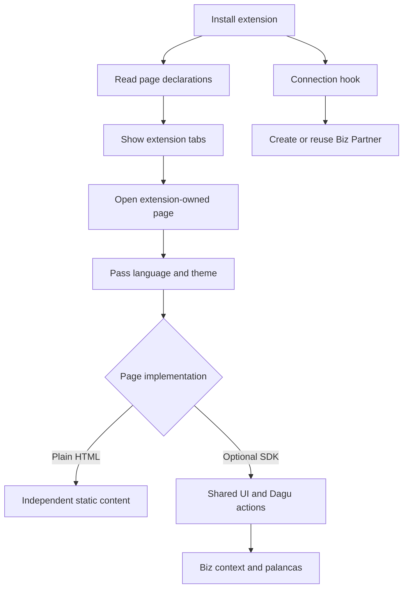
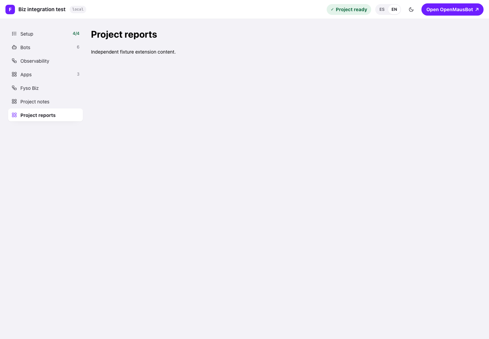
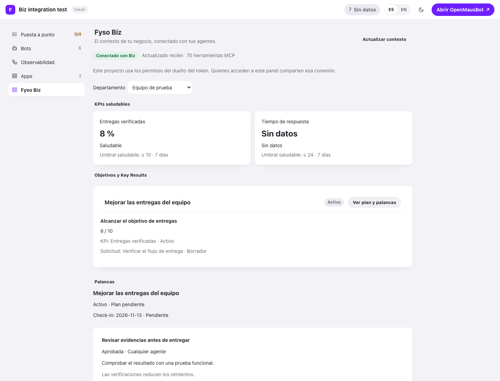
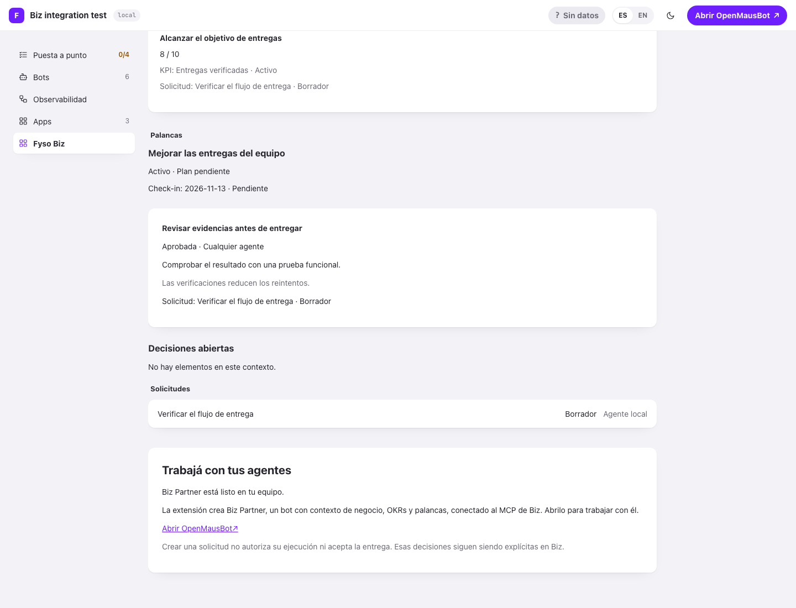
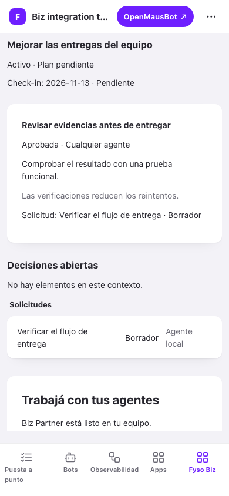

# Initial integration evidence (historical)

Recorded before repository extraction against framework PR #14. Source paths and bundled-install commands below describe that validation snapshot. The independent v0.1.0 package is validated by its own unit/packaging tests and GitHub Actions; see the repository README for current commands.

# Extension-owned pages and Fyso Biz — local evidence

## Overview

Extensions now contribute their own tabs and static pages through native page declarations. The framework provides generic navigation, authenticated static hosting and an optional ES-module panel SDK. Biz owns its business screen, translations, styles, contextual bot and MCP connection; no Biz route or screen is compiled into the host.

Verified locally on 2026-11-07 UTC: an independent plain HTML extension added two pages; the Biz page used the same host contract and the shared SDK to read real MCP context. The supplied test token discovered 70 tools/seven departments; the selected department had five KPIs/two active objectives, and one objective had three palancas. No Biz business records were mutated.

## Contents

- [User flow](#user-flow)
- [Acceptance matrix](#acceptance-matrix)
- [Visual evidence](#visual-evidence)
- [Automated validation](#automated-validation)
- [Scope and limitations](#scope-and-limitations)
- [Handoff signals](#handoff-signals)

## User flow

Install an extension through Copier. Its page declarations populate navigation only while installed. Each entry opens that extension's own static page through the generic host. Pages can use plain HTML or the optional SDK for the shared theme/language, UI and Dagu clients.

For Biz, configure the encrypted personal token and restart the project stack to load it into OMB. Its idempotent connection hook creates Biz Partner through native Bot Architect plan/apply, with business context, project-root MCP access and ask approval. Reconnection preserves the bot's ID and customizations. Choose a department and objective to read KPIs, KRs, palancas and requests.



## Acceptance matrix

| Scenario | Expected result | Status | Evidence |
|---|---|---|---|
| Arbitrary extension pages | Independent extension adds two working tabs/pages | ✅ | Live generic-page browser smoke |
| Copier packaging | Biz/starter produce their own public pages without installing author sources | ✅ | Executable Copier test |
| Conditional navigation | Entries absent before install, present after install, absent after removal | ✅ | UX browser smoke |
| Generic page hosting | Public HTML loads; other extension slots and traversal paths return 404 | ✅ | Live generic-page smoke |
| Shared language/theme | Parent changes propagate into the optional-SDK page | ✅ | UX browser smoke |
| Biz context and native palancas | Real department → objectives/KRs → vision_objetivo | ✅ | Live Biz browser: 2 objectives, 3 palancas |
| Dedicated bot | Native guarded create, contextual profile, root MCP binding | ✅ | Real Bot Architect create/read in isolated project |
| Idempotency | Repeat connection returns same bot with created:false | ✅ | Real repeat hook plus provisioning tests |
| Null/range semantics and failed reads | Preserve null/zero, both range bounds, clear stale context | ✅ | Adapter and UX tests |
| Desktop/mobile | No horizontal overflow in host or embedded page | ✅ | UX smoke and inspected captures |
| Authenticated stack | Doctor passes with Biz and independent pages installed | ✅ | Isolated mise run doctor |
| Multi-user scope | Foreign department denied for a second user | ⚠️ | Second token not supplied |
| Independent tagged release | Published extension repository/catalog entry | ⚠️ | Not published |

## Visual evidence

### Independent extension — own tabs and own content

<details><summary>Show generic extension pages (live local fixture)</summary>

An independent static HTML extension registers Project notes and Project reports. The real host navigates to each page without any extension-specific code in the core. This screenshot uses only synthetic fixture content.

<p align="center"></p>
</details>

### Biz — extension-owned business context

<details><summary>Show desktop context and plan (synthetic MCP data)</summary>

The real host embeds Biz's independently built page. Its own code displays KPIs, objectives/KRs and the native objective plan. These captures use fixture MCP/Dagu outputs; real authenticated reads were validated separately without private screenshots.

<p align="center"></p>
<p align="center"></p>
</details>

### Biz — mobile page

<details><summary>Show mobile page (synthetic MCP data)</summary>

At 390 px width, the embedded plan fits the page and Biz remains available in the host's bottom navigation. The executable smoke checks both host and page for horizontal overflow.

<p align="center"></p>
</details>

## Automated validation

Run from the framework checkout unless stated otherwise. The browser scripts use the environment's existing Playwright installation; no browser dependency is installed into generated projects.

```sh
node --test tests/biz.test.cjs tests/biz-bot.test.cjs tests/extensions.test.cjs
# 22 passed: 8 Biz adapter + 3 bot provisioning + 11 extension contract tests.

python3 -m unittest discover -s tests -p test_extension_pages_copier.py
# 1 passed: real Copier framework → Biz + extension starter → own page slots.

npm --prefix template/framework/panel run build
node template/framework/panel/node_modules/typescript/bin/tsc -p template/framework/extensions/biz/tsconfig.json --noEmit
node template/framework/panel/node_modules/vite/bin/vite.js build --config template/framework/extensions/biz/vite.config.mjs
# Host/SDK build, extension typecheck and independent page build passed.

node tests/extension-pages-browser.cjs
# Independent extension, 2 pages, working navigation/content,
# private slots/traversal blocked, 0 page exceptions.

node tests/biz-browser.cjs
# Extension-owned page, conditional navigation, context/plan, null values,
# shared ES/EN and theme, no mobile overflow, stale-data clearing,
# uninstalled page unmounted, 0 page exceptions, 3 screenshots.

node scripts/check-biz-live.cjs
# 70 tools, 7 departments, selected 5 KPIs/2 objectives/3 palancas.
# Cross-user isolation not checked: second token missing. Biz mutations: 0.

node tests/biz-live-browser.cjs
# Extension-owned page on the real isolated stack: connected,
# 2 objectives, 3 palancas, 0 page exceptions and Dagu HTTP errors.

# In the isolated generated project:
mise exec -- framework/scripts/connect-extensions.sh
# First call created Biz Partner; repeat returned the same ID, created:false.
mise run doctor
# All checks passed.

# Source checks:
bash scripts/check-paths.sh
git diff --check
```

Browser tests run headless, one context per command, no retries, against `http://panel.localhost:9460`. The generic-page and Biz live smokes use the real Caddy, project inventory and Dagu stack. The Biz UX smoke intercepts MCP/Dagu results and installation metadata to produce deterministic, sanitized acceptance states; it does not replace real Copier installation or authenticated MCP validation.

## Scope and limitations

- Pages are trusted installed code sharing the authenticated project origin, not a sandbox or separate Biz identity. Public assets are restricted to extension panel directories.
- The panel is read-only for Biz. Native bots retain instructed mutation tools under Biz authorization. Conversational bot tool use was not part of this smoke; native bot profile/MCP binding and authenticated adapter reads were verified separately.
- Dagu retains selected business fields. Only the supplied primary token was available; multi-user isolation remains unverified.
- No remote CI/deployment or independently tagged catalog release is claimed.
- A bundled directory is installable; its independent versioned publication remains pending. Removal preserves the project-owned bot and encrypted secret.

## Handoff signals

- Local Biz page: `http://panel.localhost:9460/#/extensions/biz/overview`.
- Independent fixture: `http://panel.localhost:9460/#/extensions/example-pages/notes`.
- Test credentials: ignored `.data/biz-test/connection.env`; optional second token goes in `BOT_FYSO_BIZ_SECONDARY_TOKEN`.
- [Generic page contract](../../../docs/extensions-contract.md#9-extension-owned-tabs-and-pages) · [Biz contract](../../../docs/fyso-biz.md).

After updating the PR branch onto current main, the same 22 tests plus 8 native MCP/Bot Architect compatibility tests passed (30 total). The Copier packaging test also passed again on that final branch. Socket-based MCP tests ran with local-listener permission; an earlier sandbox-only attempt was blocked by EPERM before requests ran.
